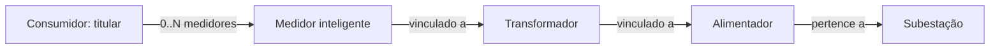

# Modelo de domínio

O Power Grid Control Center reúne o cadastro da infraestrutura elétrica, medições, eventos operacionais, alertas e histórico de atendimento. O modelo atende ao recorte inicial das histórias descritas nas Sprints 1 e 4.

## Escopo do MVP

- Consumidor representa o titular do fornecimento, pessoa física ou jurídica.
- Um consumidor pode possuir zero ou vários medidores. A localização do medidor representa temporariamente o endereço de fornecimento.
- O caminho cadastral é **Medidor → Transformador → Alimentador → Subestação**.
- O transformador possui alimentador obrigatório; sua subestação é obtida por esse alimentador, sem referência duplicada.
- Medidores em estoque podem não possuir consumidor nem transformador. Esses vínculos são preenchidos na instalação.
- Eventos distinguem o usuário que registrou a ocorrência do usuário responsável por acompanhá-la.
- Alertas podem estar associados a um ativo ou à rede monitorada.
- Cada usuário possui um perfil de acesso; cargo profissional é uma informação independente.
- Integrantes de equipes possuem contas de usuário. O registro granular de executores e a designação simultânea de várias equipes ficam para uma etapa posterior.

O vínculo cadastral permite organizar os ativos, mas não representa a topologia elétrica completa nem determina o fluxo instantâneo de potência.

## Estrutura dos cadastros

### Entidades e atributos

| Entidade | Atributos relevantes |
|---|---|
| AtivoRede | Identificador, nome, localização geográfica, estado operacional e data de instalação |
| Subestacao | Tensão nominal e capacidade em MVA |
| Transformador | Capacidade operacional em MVA e alimentador; subestação derivada do alimentador |
| Alimentador | Identificação, tensão nominal e subestação |
| LinhaTransmissao | Extensão, tensão de operação e extremidades cadastrais |
| UsinaGeradora | Tipo de geração e capacidade máxima em MW |
| MedidorInteligente | Número de série, localização/endereço de fornecimento, consumidor e transformador |
| Consumidor | Nome/razão social, documento, tipo de pessoa e endereço de correspondência, quando aplicável |
| Usuario | Nome, matrícula, e-mail, hash de senha, perfil e cargo profissional |
| EquipeManutencao | Nome, situação, responsabilidades e especialidades |

AtivoRede é a base conceitual de subestações, transformadores, alimentadores, linhas, usinas e medidores. Consumidor, usuário e equipe não são subclasses de ativo elétrico. No schema inicial, cada subtipo possui tabela própria cuja chave primária também referencia `ativo_rede.id`.

Capacidade nominal pertence ao cadastro. Carga, geração, consumo e última leitura são dados de monitoramento. Grandezas de capacidade devem possuir unidade explícita; a capacidade de transformadores aceita somente valores positivos, conforme US03.

### Relacionamentos

| Relação | Definição |
|---|---|
| Subestacao → Alimentador | Cada alimentador está vinculado a uma subestação. Uma subestação pode possuir vários alimentadores. |
| Subestacao → Transformador | A subestação do transformador é derivada por JOIN com seu alimentador. Uma subestação pode possuir vários transformadores por esse caminho. |
| Alimentador → Transformador | Cada transformador cadastrado possui exatamente um alimentador. Um alimentador pode possuir vários transformadores. |
| Transformador → Medidor | O medidor pode possuir zero ou um transformador. Quando vinculado, seu alimentador é obtido por esse caminho, sem associação direta independente. |
| Consumidor → Medidor | O titular pode possuir zero ou vários medidores. O vínculo do medidor com o titular é opcional no banco para permitir estoque. |
| AtivoRede → Medicao | Cada medição identifica seu ativo de origem; um ativo pode possuir várias medições. |
| AtivoRede → EventoOperacional | Cada evento inicial envolve um ativo; um ativo pode possuir vários eventos. |
| Usuario → EventoOperacional | Registrador e responsável são referências independentes e podem apontar para a mesma pessoa. |
| AtivoRede → Alerta | Cada alerta de escopo ATIVO referencia um ativo; alertas de escopo REDE_MONITORADA não possuem ativo associado. |

A tabela `transformador` exige `alimentador_id NOT NULL`. As colunas `medidor_inteligente.transformador_id` e `medidor_inteligente.consumidor_id` aceitam NULL, permitindo o cadastro de equipamentos em estoque. As condições de instalação, transferência e retirada de campo serão detalhadas nos contratos correspondentes.

A tabela `transformador` não possui `subestacao_id`. A referência exigida por US03 é obtida por `transformador.alimentador_id → alimentador.subestacao_id`. Não há chave estrangeira composta para comparar subestações. O cadastro mínimo de alimentadores precede US03.

### Cadastro de subestações

O contrato de criação de US01 exige nome, latitude, longitude, tensão nominal em kV, capacidade em MVA e data de instalação. O nome recebe trim, não pode ficar vazio e possui limite de 255 caracteres, sem unicidade. Coordenadas aceitam até sete casas decimais, nos intervalos inclusivos de -90 a 90 e -180 a 180. Tensão e capacidade devem ser positivas, com até 13 dígitos inteiros e seis decimais. Entradas que excedam a precisão são rejeitadas, sem arredondamento silencioso. Datas futuras são permitidas.

O estado operacional, quando omitido ou nulo na criação, será OPERACIONAL; valores fora do catálogo serão rejeitados. O identificador é gerado em ativo_rede e compartilhado com subestacao. A persistência JPA utiliza herança JOINED; obrigatoriedade adicional, normalização, validação de precisão e aplicação do estado padrão pertencem ao contrato da API e não alteram a V1.

### Cadastro de alimentadores

O cadastro exige nome, latitude, longitude, tensão nominal em kV, data de instalação e subestacaoId. Nome recebe trim, não pode ser vazio e admite até 255 caracteres, sem unicidade. Coordenadas aceitam até sete casas decimais e respeitam os limites de latitude e longitude. Tensão deve ser positiva, com até 13 dígitos inteiros e seis decimais; excesso de precisão é rejeitado sem arredondamento. Datas futuras são permitidas. Estado omitido ou nulo assume OPERACIONAL. Não há capacidadeMva no Alimentador.

SubestacaoId deve ser inteiro positivo compatível com Long e apontar para uma subestação existente; o contrato HTTP prevê 404 para referência inexistente e 400 para entrada inválida. Não há validação cruzada de tensão nem restrição pelo estado da subestação. O mapeamento JPA utiliza associação ManyToOne obrigatória e LAZY, sem cascata para a subestação. O DTO valida os campos e a precisão; o serviço verifica a existência da subestação antes de alterar a entidade. A edição pode trocar a subestação por outra existente, mantendo o ID do alimentador.

### Cadastro de transformadores

O cadastro estrutural exige nome, latitude, longitude, capacidadeMva, dataInstalacao e alimentadorId. Nome recebe trim, não pode ser vazio e admite até 255 caracteres, sem unicidade. Coordenadas respeitam os limites geográficos e até sete casas decimais. Capacidade é positiva, obrigatória e admite até 13 dígitos inteiros e seis decimais, sem arredondamento de entrada. Datas futuras são permitidas. Estado omitido ou nulo assume OPERACIONAL.

AlimentadorId deve ser inteiro positivo compatível com Long e apontar para um alimentador existente; o contrato HTTP prevê 404 para referência inexistente e 400 para entrada inválida. O cliente não informa subestacaoId: a subestação é derivada do alimentador. A API retorna alimentadorId e subestacaoId; a edição permite trocar o alimentador, e a resposta reflete a subestação do novo vínculo. Não há tensão nominal própria nem restrição pelo estado do alimentador. O mapeamento JPA utiliza herança JOINED e associação ManyToOne obrigatória e LAZY, sem cascata para o alimentador. Percentual de carga e temperatura pertencem ao futuro módulo de Monitoramento.

### Estoque e instalação de medidores

O cadastro inicial exige nome e número de série, com trim e limites de 255 e 128 caracteres. A série preserva capitalização, zeros e pontuação interna; a unicidade distingue maiúsculas de minúsculas. O medidor nasce em estoque, com vínculos, coordenadas, endereço de fornecimento e data de instalação nulos. Estado operacional omitido ou nulo assume OPERACIONAL, independentemente da instalação.

A instalação é uma operação específica que preenche atomicamente consumidor, transformador, latitude, longitude e data de instalação não futura. As coordenadas respeitam limites geográficos e até sete casas decimais. Endereço de fornecimento permanece opcional. Não existe coluna ou enum adicional de estoque/instalado; a situação é inferida pelo conjunto de dados de instalação. Instalação de medidor já instalado retorna conflito. Transferência, retirada e reinstalação ficam para contratos com histórico.

### Consumidor e histórico de fornecimento

O MVP não contém UnidadeConsumidora. A identidade do titular e a localização do medidor são suficientes para o cadastro inicial, mas não preservam integralmente a identidade de uma instalação após trocas de titular ou de medidor.

Transferências e reinstalações precisam de tratamento histórico antes de serem disponibilizadas. Uma alteração de vínculo atual não deve reatribuir medições antigas ao novo titular. O atributo `documento` é obrigatório e único, assim como e-mail, matrícula e número de série do medidor. O contrato de cadastro exige nome/razão social, tipo PF/PJ e documento. Documento aceita máscara convencional ou formato sem máscara; deve preservar zeros iniciais, remover a pontuação prevista e converter letras para maiúsculas. A validação de formato e dígitos verificadores contempla CPF, CNPJ numérico e CNPJ alfanumérico. Endereço de correspondência é opcional, textual, com trim e vazio convertido em nulo. Não há campos de telefone ou e-mail.

### Persistência inicial

A migration `V1__schema_inicial.sql` contém os cadastros, vínculos de integrantes, campos comuns dos eventos e alertas. Um evento pode possuir uma equipe designada; essa associação não substitui seu responsável individual.

E-mail, matrícula, número de série do medidor e documento do consumidor possuem restrições NOT NULL e UNIQUE. O e-mail recebe `trim` e conversão para minúsculas com `Locale.ROOT` na aplicação, antes de inserções e atualizações JPA e antes da busca para autenticação. A unicidade compara os valores armazenados; normalização de documento é aplicada pelo serviço de cadastro do titular antes da consulta de unicidade e da persistência. Inserções SQL, incluindo o provisionamento inicial, devem fornecer e-mails já normalizados.

As chaves primárias compartilhadas dos ativos permitem o mapeamento JPA com herança JOINED. A exclusividade dos subtipos será garantida pela camada de aplicação/JPA, sem restrições adicionais no banco. A criação transacional deverá manter a consistência entre o ativo e seu subtipo.

Situações iniciais de eventos, equipes e alertas não possuem defaults. Campos cuja obrigatoriedade permanece em aberto aceitam NULL na estrutura inicial; isso não define as regras dos futuros comandos de cadastro.

A V3 define as extremidades das linhas por subestacao_origem_id e subestacao_destino_id, ambos NOT NULL e com FKs para subestacao.id. Um CHECK impede origem e destino iguais. O mapeamento de LinhaTransmissao utiliza herança JOINED e associações LAZY, sem cascata. Medições de linhas usam a V4. Histórico de alterações e detalhes específicos de interrupção/manutenção terão migrations próprias antes das funcionalidades correspondentes. A designação atual de equipe não constitui histórico de atendimento.

## Medições e indicadores

A consulta unificada usa a identidade (tipoAlerta, idOrigem) e preserva os estados da origem. AlertaDashboardResponseDTO mantém vínculos, auditoria e snapshots técnicos, acrescentando uma descrição de apresentação. O histórico inclui todos os estados por padrão; reconhecimento e restabelecimento não são tratados como equivalentes. Datas ausentes são preservadas e ordenadas ao final; filtros temporais não incluem registros sem ocorridoEm.

A V11 acrescenta criticidade obrigatória aos alertas automáticos, reutilizando Criticidade (BAIXA, MEDIA, ALTA, CRITICA). A política inicial gravada na geração é ALTA para sobrecarga/tensão e MEDIA para comunicação. O backfill aplica essa política aos registros anteriores; não reconstrói uma classificação histórica originalmente inexistente. A classificação persistida é um snapshot e não depende de uma regra recalculada pela consulta.

AlertaDashboardView projeta vw_alertas_dashboard, uma view comum com UNION ALL dos alertas genéricos e das três tabelas automáticas. A identidade composta é (idOrigem, tipoAlerta), com tipos GENERICO/SOBRECARGA/TENSAO/COMUNICACAO. A entidade é imutável e o repositório expõe somente consultas. A projeção inclui criticidade, escopo, ativo/fonte/medição, ocorridoEm, statusOrigem, subtipo, mensagem genérica, campos de reconhecimento/restabelecimento e snapshots técnicos. ocorridoEm usa geradoEm nas três primeiras origens e detectadoEm em comunicação. Dados não disponíveis permanecem nulos, inclusive campos legados do alerta genérico. Os ciclos de vida das origens não são convertidos em um estado único.

A V10 adiciona monitoradaDesde obrigatório e ultimaComunicacaoEm opcional em FonteMedicao. A comunicação é acompanhada por fonte, sem alterar EstadoOperacional de AtivoRede. O backfill usa o maior recebidoEm das medições existentes de linhas e transformadores; monitoradaDesde recebe o instante da migração. Novas fontes recebem início UTC ao persistir. AlertaComunicacao possui identidade própria, fonte e ativo obrigatórios (N:1, LAZY, sem cascata), snapshots de início/última comunicação e tolerância positiva, detectadoEm e restabelecidoEm. StatusComunicacao é independente de StatusAlerta: ATIVO exige restabelecidoEm nulo; RESTABELECIDO exige instante preenchido. O motor manual garante exclusividade de episódio ativo por fonte ao bloquear a fonte antes de verificar ou criar o alerta. A avaliação fixa o instante UTC, usa timeout global positivo (300 segundos por padrão) e considera perda somente após base + tolerância; base é o último contato ou o início do monitoramento. As ingestões de linhas e transformadores bloqueiam a mesma fonte antes de capturar recebidoEm, com precisão de microssegundos. O registro de comunicação exige a transação da ingestão: ultimaComunicacaoEm recebe recebidoEm e o episódio ATIVO passa para RESTABELECIDO com restabelecidoEm igual ao mesmo instante UTC. Falhas posteriores revertem leitura, contato e restabelecimento. O histórico preserva os snapshots e o primeiro instante de restabelecimento; nova ausência pode originar outro episódio. Leituras históricas comprovam contato pelo recebimento atual, sem comprovar atualidade das condições elétricas.

A V9 introduz AlertaTensao separado de AlertaSobrecarga, compartilhando StatusAlerta. Um ativo possui vários alertas; cada leitura de linha pode originar zero ou um alerta de tensão. A entidade preserva tipo (SUBTENSAO/SOBRETENSAO), tensão medida, referência e limites, além de geração e reconhecimento. Tensão medida pode ser zero; referência e limites devem ser positivos. ATIVO exige reconhecimento/usuário nulos e RECONHECIDO exige ambos preenchidos. As associações são LAZY e sem cascata. O detector usa tensaoOperacaoKv como referência didática, com fatores exatos 0.95/1.05 e fronteiras inclusivas: <=inferior é SUBTENSAO e >=superior é SOBRETENSAO. Não há avaliação quando a leitura não possui tensão; referência inválida com tensão informada impede a ingestão. Medição e alerta compartilham a transação. O reconhecimento usa o usuário da sessão e o horário UTC do servidor, com precisão de microssegundos. A operação transacional adquire bloqueio pessimista e preserva o primeiro autor e instante em repetições ou chamadas concorrentes. Recuperação elétrica permanece separada do reconhecimento; uma leitura normal não encerra alertas anteriores.

A V8 introduz AlertaSobrecarga com identidade própria, ativo obrigatório (FK para AtivoRede), medição de transformador obrigatória e exclusiva, snapshot da carga percentual e do limiar, status e instante de geração. Um ativo pode possuir vários alertas e uma medição pode originar zero ou um alerta. ATIVO exige reconhecimento e usuário nulos; RECONHECIDO exige ambos preenchidos. O usuário de reconhecimento é opcional no vínculo, obrigatório condicionalmente pelo CHECK. A entidade não se confunde com o alerta genérico da US20. O serviço de geração deriva o ativo da própria medição e exige a transação de ingestão. O limiar é fixo em 100.000000 e a comparação considera o percentual produzido pela US11, com seis casas. Uma falha no alerta desfaz a medição. Cada leitura excedente, inclusive atrasada, gera um registro próprio; não há encerramento automático. ATIVO significa pendente de reconhecimento, não confirmação de sobrecarga atual. O reconhecimento por sessão é idempotente e transacional, usando bloqueio pessimista para preservar o primeiro autor e horário em disputas concorrentes. O timestamp é normalizado para microssegundos, precisão do banco, antes de persistir e responder. Reconhecimento não encerra nem comprova recuperação elétrica.

A V7 generaliza FonteMedicao → AtivoRede (N:1 obrigatório, LAZY), migrando o antigo vínculo de linha sem mudar os IDs. APIs existentes de linhas preservam seus contratos. O serviço deve restringir o alvo ao tipo de ativo aceito pela rota; a FK simples comprova apenas sua existência. A referência de subestação permanece aplicável às fontes de linhas.

MedicaoTransformador referencia uma fonte (N:1 obrigatório, LAZY), com medidoEm, recebidoEm, potenciaAparenteMva não negativa e capacidadeReferenciaMva estritamente positiva. A capacidade de referência é um snapshot independente do cadastro, capturado pelo servidor na ingestão; mudanças posteriores da capacidade não alteram esse valor. Carga percentual é derivada no serviço por S/capacidadeReferencia*100, sem coluna própria e sem limite artificial de 100%.

A V6 adiciona frequenciaHz opcional em MedicaoLinha, com unidade Hz e NUMERIC(9,6). Valor informado deve ser estritamente positivo; ao menos uma entre as cinco grandezas ingeridas deve existir. Frequência nula preserva leituras anteriores. Fator de potência e sua situação são derivados no serviço a partir de P e Q da mesma leitura; não são atributos persistidos. O módulo do FP usa |P|/sqrt(P²+Q²), com resultado em seis casas HALF_EVEN. P ou Q ausente resulta em DADOS_INSUFICIENTES; ambos zero, em POTENCIA_APARENTE_NULA; nos demais casos, em CALCULADO. A direção permanece nos sinais das potências e no terminal de referência. O modelo didático considera regime senoidal sem harmônicos.

A V5 estende MedicaoLinha com potenciaAtivaMw (MW) e potenciaReativaMvar (MVAr), ambas opcionais em NUMERIC(19,6), com sinal. Ao menos uma entre tensão, corrente, potência ativa e reativa deve existir. FonteMedicao passa a possuir subestacaoReferencia opcional (N:1, LAZY), preservando nulo para fontes antigas. A convenção positiva indica entrada na linha pelo terminal de referência; as potências possuem sinais independentes. A Camada Web exige referência válida para ingestão de potência. Não existe endpoint de edição ou reatribuição de fontes; se disponibilizado futuramente, deverá preservar o histórico após leituras. A FK simples garante existência da subestação, não sua condição de extremidade da linha.

A V4 introduz FonteMedicao → LinhaTransmissao (N:1 obrigatório) e MedicaoLinha → FonteMedicao (N:1 obrigatório). A linha da leitura é derivada da fonte. FonteMedicao possui identificador único e origem REAL/SIMULADA. MedicaoLinha mantém os instantes medidoEm e recebidoEm e as grandezas opcionais tensaoKv e correnteA, exigindo pelo menos uma delas. Ambas representam magnitudes RMS não negativas; ausência não equivale a zero. A ingestão valida o vínculo fonte–linha e aceita instantes até 60 segundos à frente do relógio do servidor, com tolerância configurável. O instante de recebimento é gerado no backend. A regra de imutabilidade do vínculo após leituras deverá ser aplicada quando houver edição de fontes; esse endpoint ainda não existe.

Medicao registra o ativo de origem, o instante da leitura, as grandezas com suas unidades e a origem real ou simulada dos valores. O monitoramento abrange tensão, corrente, potência ativa e reativa, frequência, fator de potência, consumo e demanda.

Carga, perdas e disponibilidade dependem de fórmulas, períodos e fontes de dados definidos. A cadeia cadastral permite agrupar medidores por transformador e alimentador, mas não substitui essas definições.

Diretrizes para os contratos de medição:

- Usar data e horário completos, com política de fuso explícita.
- Diferenciar valor nominal, leitura e indicador calculado.
- Identificar a janela temporal de consumo e energia; kWh não representa potência instantânea.
- Diferenciar ausência de dados de leitura zero.
- Diferenciar perda de comunicação de interrupção do fornecimento.
- Identificar a capacidade de referência no cálculo de carga.
- Preservar valores de sobrecarga; uma leitura superior a 100% não deve ser limitada automaticamente.
- Definir fronteira de medição, sincronização e tratamento de dados insuficientes antes de calcular perdas.

## Eventos operacionais

EventoOperacional contém identificador, ativo, categoria, criticidade, descrição, situação, `registradorUsuario`, `responsavelUsuario`, `inicioPrevisto`, `inicioEfetivo` e informações de término.

O registrador é o usuário autenticado que inseriu a ocorrência. O responsável é o usuário que acompanha o evento, obrigatório em US16. Equipe designada não substitui essa responsabilidade individual.

### Categorias

| Categoria | Significado |
|---|---|
| MANOBRA | Ação operacional de alteração da configuração da rede |
| DESLIGAMENTO_PROGRAMADO | Ação de desligamento previamente planejada |
| INTERRUPCAO_FORNECIMENTO | Ocorrência efetiva de perda do fornecimento |
| SOBRECARGA | Ocorrência de operação acima da capacidade considerada |
| FALHA_EQUIPAMENTO | Falha de funcionamento de um equipamento |
| MANUTENCAO | Atividade de manutenção registrada ou acompanhada |

Cada registro possui uma categoria principal. Uma interrupção pode decorrer de um desligamento programado; a ação e seu efeito são fatos distintos. A correlação entre eventos será detalhada em etapa posterior.

Os atributos comuns pertencem ao evento. Informações específicas, como causa da interrupção, quantidade de consumidores afetados, tipo de manutenção e relatório técnico, complementam a ocorrência correspondente. Manutenção compartilha a identidade e o ciclo de vida do evento.

### Datas e situação

Início previsto e início efetivo são campos diferentes. Uma previsão não preenche automaticamente o instante efetivo.

Na criação de MANOBRA e DESLIGAMENTO_PROGRAMADO pela US16, inicioPrevisto é obrigatório e terminoPrevisto é opcional, maior ou igual ao início previsto. Previsões passadas são permitidas. Datas possuem fuso. A situação inicial é ABERTO; inicioEfetivo, terminoEfetivo e equipe designada permanecem nulos. Registros efetivos e transições serão detalhados posteriormente. O banco compara separadamente cada par previsto ou efetivo e permite instantes iguais.

A referência para o ciclo básico é `ABERTO → EM_ANDAMENTO → CONCLUIDO`. Estado inicial, permissões, encerramento e exceções serão detalhados nas operações de US16 e US18.

## Equipes e manutenção

Três associações possuem significados distintos:

| Associação | Finalidade |
|---|---|
| VinculoEquipe | Identificar usuários integrantes da equipe e a vigência do vínculo |
| DesignacaoEquipeEvento | Registrar a equipe designada para atender um evento |
| ParticipacaoManutencao | Registrar quem efetivamente executou a manutenção |

Participar de uma equipe não comprova participação em todos os seus serviços. A composição atual da equipe não substitui o registro dos executores de uma manutenção passada.

Todo integrante terá conta de usuário no MVP. Perfil de acesso não comprova qualificação profissional. Regras de exclusividade, disponibilidade e limite de atendimentos serão definidas em US04.

O registro granular de executores e múltiplas equipes simultâneas não integram a primeira entrega. O registro de eventos de US16 funciona sem designação obrigatória de equipe.

## Alertas

Alerta contém identificador, tipo, criticidade, instante de geração, situação e escopo. O campo tipo é a mensagem principal exibida pela interface, com até 128 caracteres; não existe campo separado de descrição na V1 nem no contrato da API.

| Escopo | Relação com ativo |
|---|---|
| ATIVO | `ativoId` obrigatório, referenciando um ativo real |
| REDE_MONITORADA | `ativoId = null`; representa uma condição geral da rede |

O campo `escopo` é explícito em ambos os casos. “Rede Geral” não será cadastrada como ativo. Em US20, a interface apresenta o ativo ou o escopo da rede, além de tipo, instante e criticidade.

Origem da detecção e escopo afetado são conceitos diferentes. A classificação de um alerta como geral depende de uma regra de avaliação; não decorre apenas da ausência de vínculo com equipamento.

Eventos e alertas possuem identidades e ciclos independentes. A geração de um alerta não cria automaticamente um evento, e concluir uma manutenção não resolve automaticamente seus alertas.

O ciclo de referência é `ABERTO → RECONHECIDO → RESOLVIDO`. US20 considera ABERTO e RECONHECIDO como ativos, excluindo RESOLVIDO. A ordem de criticidade é CRITICA, ALTA, MEDIA e BAIXA; os desempates usam geradoEm e id decrescentes. Na criação, o backend define geradoEm em UTC e situação ABERTO. Tipo, criticidade e escopo são obrigatórios no contrato de entrada. Reconhecimento e resolução preservam autor, instante e ação. Limiares, repetição, recuperação e resolução automática serão detalhados nas histórias de alertas.

## Perfis, estados e histórico

Cada usuário possui um dos perfis: Operador, Gerente de Operações ou Técnico de Manutenção. Cargo profissional é descritivo e não concede permissões. Login e obtenção de CSRF são públicos; as demais rotas exigem usuário autenticado. Futuras operações de gestão de acesso serão restritas ao perfil GERENTE_OPERACOES por segurança de método.

A autenticação utiliza sessão HTTP com cookie HttpOnly e proteção CSRF, sem JWT. O login renova o identificador da sessão e seu token CSRF; o logout invalida a sessão. As respostas de autenticação expõem somente identificador, nome, e-mail e perfil. Senhas são verificadas por BCrypt, e o cadastro exigirá no mínimo oito caracteres. A migration V2 provisiona um usuário de cada perfil com hash BCrypt previamente calculado.

O estado operacional principal do ativo é `OPERACIONAL`, `FALHA` ou `MANUTENCAO`. É uma classificação resumida: não descreve simultaneamente todas as condições de um equipamento em falha durante uma manutenção.

Estado do ativo, conectividade, situação do evento e criticidade do alerta são dimensões distintas. As interfaces existentes apresentam catálogos que precisam ser alinhados aos contratos:

| Dimensão | Referência de modelagem | Detalhamento necessário |
|---|---|---|
| Conectividade | DESCONHECIDA, ONLINE, OFFLINE | Tolerância a atraso e recuperação |
| Equipe | DISPONIVEL, EM_ATENDIMENTO, FORA_DE_SERVICO | Disponibilidade e transições |
| Criticidade de evento | Baixa, média, alta | Classificação por categoria |
| Criticidade de alerta | Informativo, atenção, crítico | Ordem, elegibilidade e regras de geração |

Mudanças de situação e responsabilidade devem preservar autor, instante e valores anteriores e novos. Atualizar o cadastro não executa comando físico na rede.

## Detalhamentos pendentes

| Tema | Definição necessária | Histórias |
|---|---|---|
| Vínculos cadastrais | Vigência, instalação, transferência e retirada de medidores de campo | US02, US03, US06 |
| Campos de cadastro | Obrigatoriedade dos demais campos; normalização e validação dos identificadores | US01–US07, US25 |
| Acesso | Duração da sessão; implementação das futuras operações de gestão de acesso; integração do frontend em incremento separado | US25 |
| Ciclos de eventos | Datas obrigatórias, estado inicial, conclusão e registros retrospectivos | US16, US18 |
| Alertas | Estados ativos, criticidade, reconhecimento, resolução e limites | US20–US24 |
| Equipes | Integrantes, designação simples e disponibilidade | US04, US19 |
| Indicadores | Fórmulas, períodos, fontes, qualidade e atualização | US08–US15 |
| Geografia | Extremidades, traçados e conexão de usinas | US02, US05, US13 |
| Histórico de fornecimento | Trocas de titular e medidor | US06, US07 |

## Compatibilidade com os artefatos existentes

| Artefato | Divergência |
|---|---|
| Diagramas de classes e banco | Alimentador ausente |
| Relação Consumidor–Medidor | Mínimo 1..* no diagrama de classes e medidor_id no consumidor no banco |
| Diagrama de banco | Coluna dccumento; nomenclatura atual: documento |
| Diagrama de classes / SmartMeters | Ligação com linha ou alimentador direto; modelo atual inclui transformador |
| Transformadores | Subestação textual e ausência de alimentador |
| Consumidores | Alimentador independente e ausência de documento |
| Eventos | Responsável textual e início sem separação entre previsto e efetivo |
| Alertas | “Rede Geral” no campo de ativo |
| Classes de eventos | Três subclasses não explicitam as seis categorias |

Os diagramas anteriores precisam ser sincronizados com este modelo e com o schema inicial. As Sprints permanecem registros históricos do planejamento.

## Referências

- [Sprint 1](Sprint1_PowerGridControlCenter.pdf), páginas 2–5: personas e histórias.
- [Sprint 4](Sprint4_Replanejamento_PowerGridControlCenter.pdf), páginas 3–5: pendências e critérios de aceitação.
- [Diagrama de classes](diagramas/DiagramaDeClasses.png).
- [Diagrama de banco de dados](diagramas/DiagramaBancoDeDados.pdf).
- [Backlog](backlog.md): prioridades, critérios e tarefas.

## Histórico de transições de eventos operacionais — US18

A V12 introduz HistoricoEventoOperacional com identidade própria, associações obrigatórias N:1 para EventoOperacional e Usuario, situações anterior/nova, alteradoEm e comentario de até 1.000 caracteres. As associações são LAZY, sem cascata de persistência ou exclusão. A atualização do histórico é imutável no Hibernate; o repositório não expõe exclusão. A FK preserva os vínculos de auditoria. Não há coleção bidirecional no evento.

SituacaoEventoOperacional define ABERTO, EM_ANDAMENTO e CONCLUIDO. O CHECK do histórico permite somente ABERTO → EM_ANDAMENTO e EM_ANDAMENTO → CONCLUIDO. O estado do evento pai e as datas efetivas continuam com os mapeamentos existentes; a atualização conjunta com o histórico será responsabilidade do serviço transacional. Este histórico é independente dos alertas e da view da US24.

A migração normaliza a grafia de situações conhecidas sem alterar datas nem inventar usuário ou instante de ações passadas. Estados desconhecidos/nulos são preservados para tratamento explícito no fluxo de negócio, e nenhum histórico retroativo é criado. Não há novas restrições de ciclo sobre o evento pai neste lote; as comparações temporais já presentes na V1 permanecem válidas.
