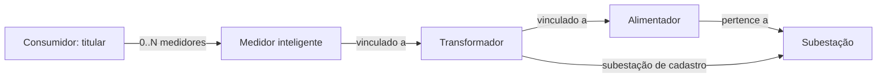

# Modelo de domínio

O Power Grid Control Center reúne o cadastro da infraestrutura elétrica, medições, eventos operacionais, alertas e histórico de atendimento. O modelo atende ao recorte inicial das histórias descritas nas Sprints 1 e 4.

## Escopo do MVP

- Consumidor representa o titular do fornecimento, pessoa física ou jurídica.
- Um consumidor pode possuir zero ou vários medidores. A localização do medidor representa temporariamente o endereço de fornecimento.
- O caminho cadastral é **Medidor → Transformador → Alimentador → Subestação**.
- Transformador mantém também sua referência à subestação, exigida por US03.
- Eventos distinguem o usuário que registrou a ocorrência do usuário responsável por acompanhá-la.
- Alertas podem estar associados a um ativo ou à rede monitorada.
- Cada usuário possui um perfil de acesso; cargo profissional é uma informação independente.
- Integrantes de equipes possuem contas de usuário. O registro granular de executores e a designação simultânea de várias equipes ficam para uma etapa posterior.

O vínculo cadastral permite organizar os ativos, mas não representa a topologia elétrica completa nem determina o fluxo instantâneo de potência.

## Estrutura dos cadastros

### Entidades e atributos

| Entidade | Atributos relevantes |
|---|---|
| AtivoRede | Identificador, nome, localização geográfica, estado operacional e data de instalação |
| Subestacao | Tensão nominal e capacidade em MVA |
| Transformador | Capacidade operacional, subestação e alimentador |
| Alimentador | Identificação, tensão nominal e subestação |
| LinhaTransmissao | Extensão, tensão de operação e extremidades cadastrais |
| UsinaGeradora | Tipo de geração e capacidade máxima em MW |
| MedidorInteligente | Número de série, localização/endereço de fornecimento, consumidor e transformador |
| Consumidor | Nome/razão social, documento, tipo de pessoa e endereço de correspondência, quando aplicável |
| Usuario | Nome, matrícula, e-mail, hash de senha, perfil e cargo profissional |
| EquipeManutencao | Nome, situação, responsabilidades e especialidades |

AtivoRede é a base conceitual de subestações, transformadores, alimentadores, linhas, usinas e medidores. Consumidor, usuário e equipe não são subclasses de ativo elétrico. A representação dessa generalização no banco será definida no mapeamento de persistência.

Capacidade nominal pertence ao cadastro. Carga, geração, consumo e última leitura são dados de monitoramento. Grandezas de capacidade devem possuir unidade explícita; a capacidade de transformadores aceita somente valores positivos, conforme US03.

### Relacionamentos

| Relação | Definição |
|---|---|
| Subestacao → Alimentador | Cada alimentador está vinculado a uma subestação. Uma subestação pode possuir vários alimentadores. |
| Subestacao → Transformador | Cada transformador possui subestação cadastrada. Uma subestação pode possuir vários transformadores. |
| Alimentador → Transformador | O transformador referencia seu alimentador. A obrigatoriedade já na criação e a vigência dos vínculos serão detalhadas no contrato de cadastro. |
| Transformador → Medidor | O medidor referencia o transformador; seu alimentador é obtido por esse caminho, sem associação direta independente. |
| Consumidor → Medidor | O titular pode possuir zero ou vários medidores; um medidor associado ao fornecimento possui um titular atual. Medidores em estoque ainda não têm regra de cadastro definida. |
| AtivoRede → Medicao | Cada medição identifica seu ativo de origem; um ativo pode possuir várias medições. |
| AtivoRede → EventoOperacional | Cada evento inicial envolve um ativo; um ativo pode possuir vários eventos. |
| Usuario → EventoOperacional | Registrador e responsável são referências independentes e podem apontar para a mesma pessoa. |
| AtivoRede → Alerta | Cada alerta de escopo ATIVO referencia um ativo; alertas de escopo REDE_MONITORADA não possuem ativo associado. |

A cardinalidade cadastral proposta para os novos vínculos é um transformador por medidor e um alimentador por transformador. Cadastros intermediários, medidores sem titular e mudanças desses vínculos precisam de regras específicas.

A subestação do transformador e a subestação do alimentador são informações relacionadas. A validação de igualdade entre elas precisa ser definida antes da implementação de US03. Caso o alimentador seja obrigatório na criação do transformador, o cadastro mínimo de alimentadores deve preceder essa entrega.

### Consumidor e histórico de fornecimento

O MVP não contém UnidadeConsumidora. A identidade do titular e a localização do medidor são suficientes para o cadastro inicial, mas não preservam integralmente a identidade de uma instalação após trocas de titular ou de medidor.

Transferências e reinstalações precisam de tratamento histórico antes de serem disponibilizadas. Uma alteração de vínculo atual não deve reatribuir medições antigas ao novo titular. O atributo de identificação documental será denominado `documento`; obrigatoriedade, normalização e unicidade ainda serão especificadas.

## Medições e indicadores

Medicao registra o ativo de origem, o instante da leitura, as grandezas com suas unidades e a origem real ou simulada dos valores. O monitoramento abrange tensão, corrente, potência ativa e reativa, frequência, fator de potência, consumo e demanda.

Carga, perdas e disponibilidade dependem de fórmulas, períodos e fontes de dados definidos. A cadeia cadastral permite agrupar medidores por transformador e alimentador, mas não substitui essas definições.

Diretrizes para os contratos de medição:

- Usar data e horário completos, com política de fuso explícita.
- Diferenciar valor nominal, leitura e indicador calculado.
- Identificar a janela temporal de consumo e energia; kWh não representa potência instantânea.
- Diferenciar ausência de dados de leitura zero.
- Diferenciar perda de comunicação de interrupção do fornecimento.
- Identificar a capacidade de referência no cálculo de carga.
- Preservar valores de sobrecarga; uma leitura superior a 100% não deve ser limitada automaticamente.
- Definir fronteira de medição, sincronização e tratamento de dados insuficientes antes de calcular perdas.

## Eventos operacionais

EventoOperacional contém identificador, ativo, categoria, criticidade, descrição, situação, `registradorUsuario`, `responsavelUsuario`, `inicioPrevisto`, `inicioEfetivo` e informações de término.

O registrador é o usuário autenticado que inseriu a ocorrência. O responsável é o usuário que acompanha o evento, obrigatório em US16. Equipe designada não substitui essa responsabilidade individual.

### Categorias

| Categoria | Significado |
|---|---|
| MANOBRA | Ação operacional de alteração da configuração da rede |
| DESLIGAMENTO_PROGRAMADO | Ação de desligamento previamente planejada |
| INTERRUPCAO_FORNECIMENTO | Ocorrência efetiva de perda do fornecimento |
| SOBRECARGA | Ocorrência de operação acima da capacidade considerada |
| FALHA_EQUIPAMENTO | Falha de funcionamento de um equipamento |
| MANUTENCAO | Atividade de manutenção registrada ou acompanhada |

Cada registro possui uma categoria principal. Uma interrupção pode decorrer de um desligamento programado; a ação e seu efeito são fatos distintos. A correlação entre eventos será detalhada em etapa posterior.

Os atributos comuns pertencem ao evento. Informações específicas, como causa da interrupção, quantidade de consumidores afetados, tipo de manutenção e relatório técnico, complementam a ocorrência correspondente. Manutenção compartilha a identidade e o ciclo de vida do evento.

### Datas e situação

Início previsto e início efetivo são campos diferentes. Uma previsão não preenche automaticamente o instante efetivo.

US16 exige estado inicial definido e rejeição de término anterior ao início. O contrato deve especificar quais instantes são obrigatórios em cada categoria e estado, incluindo registros retrospectivos. A comparação temporal deve usar pares compatíveis, como término efetivo e início efetivo.

A referência para o ciclo básico é `ABERTO → EM_ANDAMENTO → CONCLUIDO`. Estado inicial, permissões, encerramento e exceções serão detalhados nas operações de US16 e US18.

## Equipes e manutenção

Três associações possuem significados distintos:

| Associação | Finalidade |
|---|---|
| VinculoEquipe | Identificar usuários integrantes da equipe e a vigência do vínculo |
| DesignacaoEquipeEvento | Registrar a equipe designada para atender um evento |
| ParticipacaoManutencao | Registrar quem efetivamente executou a manutenção |

Participar de uma equipe não comprova participação em todos os seus serviços. A composição atual da equipe não substitui o registro dos executores de uma manutenção passada.

Todo integrante terá conta de usuário no MVP. Perfil de acesso não comprova qualificação profissional. Regras de exclusividade, disponibilidade e limite de atendimentos serão definidas em US04.

O registro granular de executores e múltiplas equipes simultâneas não integram a primeira entrega. O registro de eventos de US16 funciona sem designação obrigatória de equipe.

## Alertas

Alerta contém identificador, tipo, criticidade, instante de geração, situação e escopo.

| Escopo | Relação com ativo |
|---|---|
| ATIVO | `ativoId` obrigatório, referenciando um ativo real |
| REDE_MONITORADA | `ativoId = null`; representa uma condição geral da rede |

O campo `escopo` é explícito em ambos os casos. “Rede Geral” não será cadastrada como ativo. Em US20, a interface apresenta o ativo ou o escopo da rede, além de tipo, instante e criticidade.

Origem da detecção e escopo afetado são conceitos diferentes. A classificação de um alerta como geral depende de uma regra de avaliação; não decorre apenas da ausência de vínculo com equipamento.

Eventos e alertas possuem identidades e ciclos independentes. A geração de um alerta não cria automaticamente um evento, e concluir uma manutenção não resolve automaticamente seus alertas.

O ciclo de referência é `ABERTO → RECONHECIDO → RESOLVIDO`. O contrato de US20 deve explicitar os estados considerados ativos. Reconhecimento e resolução preservam autor, instante e ação. Limiares, repetição, recuperação e resolução automática serão detalhados nas histórias de alertas.

## Perfis, estados e histórico

Cada usuário possui um dos perfis: Operador, Gerente de Operações ou Técnico de Manutenção. Cargo profissional é descritivo e não concede permissões. A matriz de acesso será definida em US25.

O estado operacional principal do ativo é `OPERACIONAL`, `FALHA` ou `MANUTENCAO`. É uma classificação resumida: não descreve simultaneamente todas as condições de um equipamento em falha durante uma manutenção.

Estado do ativo, conectividade, situação do evento e criticidade do alerta são dimensões distintas. As interfaces existentes apresentam catálogos que precisam ser alinhados aos contratos:

| Dimensão | Referência de modelagem | Detalhamento necessário |
|---|---|---|
| Conectividade | DESCONHECIDA, ONLINE, OFFLINE | Tolerância a atraso e recuperação |
| Equipe | DISPONIVEL, EM_ATENDIMENTO, FORA_DE_SERVICO | Disponibilidade e transições |
| Criticidade de evento | Baixa, média, alta | Classificação por categoria |
| Criticidade de alerta | Informativo, atenção, crítico | Ordem, elegibilidade e regras de geração |

Mudanças de situação e responsabilidade devem preservar autor, instante e valores anteriores e novos. Atualizar o cadastro não executa comando físico na rede.

## Detalhamentos pendentes

| Tema | Definição necessária | Histórias |
|---|---|---|
| Vínculos cadastrais | Mínimos, obrigatoriedade, vigência e medidores sem titular | US02, US03, US06 |
| Subestações relacionadas | Consistência entre transformador e alimentador | US03 |
| Campos de cadastro | Unidades, obrigatoriedade e unicidade de códigos, séries e documentos | US01–US07 |
| Acesso | Matriz de permissões e estratégia de sessão/autenticação | US25 |
| Ciclos de eventos | Datas obrigatórias, estado inicial, conclusão e registros retrospectivos | US16, US18 |
| Alertas | Estados ativos, criticidade, reconhecimento, resolução e limites | US20–US24 |
| Equipes | Integrantes, designação simples e disponibilidade | US04, US19 |
| Indicadores | Fórmulas, períodos, fontes, qualidade e atualização | US08–US15 |
| Geografia | Extremidades, traçados e conexão de usinas | US02, US05, US13 |
| Histórico de fornecimento | Trocas de titular e medidor | US06, US07 |

## Compatibilidade com os artefatos existentes

| Artefato | Divergência |
|---|---|
| Diagramas de classes e banco | Alimentador ausente |
| Relação Consumidor–Medidor | Mínimo 1..* no diagrama de classes e medidor_id no consumidor no banco |
| Diagrama de banco | Coluna dccumento; nomenclatura atual: documento |
| Diagrama de classes / SmartMeters | Ligação com linha ou alimentador direto; modelo atual inclui transformador |
| Transformadores | Subestação textual e ausência de alimentador |
| Consumidores | Alimentador independente e ausência de documento |
| Eventos | Responsável textual e início sem separação entre previsto e efetivo |
| Alertas | “Rede Geral” no campo de ativo |
| Classes de eventos | Três subclasses não explicitam as seis categorias |

Os diagramas anteriores precisam ser sincronizados com este modelo e com o futuro schema. As Sprints permanecem registros históricos do planejamento.

## Referências

- [Sprint 1](Sprint1_PowerGridControlCenter.pdf), páginas 2–5: personas e histórias.
- [Sprint 4](Sprint4_Replanejamento_PowerGridControlCenter.pdf), páginas 3–5: pendências e critérios de aceitação.
- [Diagrama de classes](diagramas/DiagramaDeClasses.png).
- [Diagrama de banco de dados](diagramas/DiagramaBancoDeDados.pdf).
- [Backlog](backlog.md): prioridades, critérios e tarefas.
